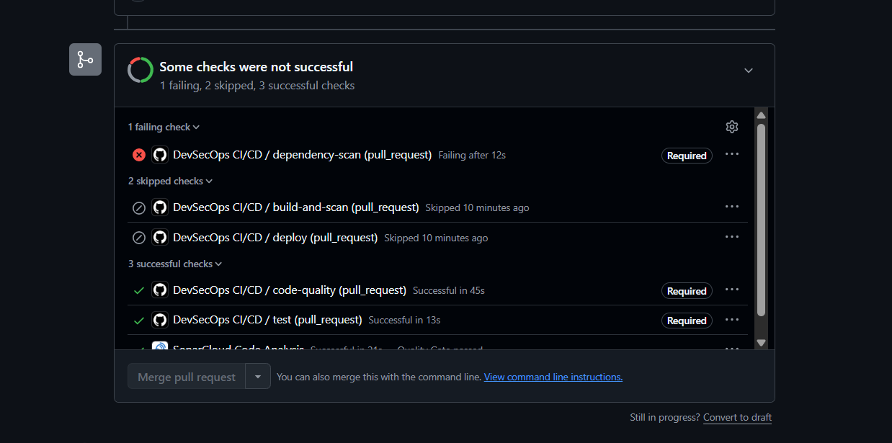
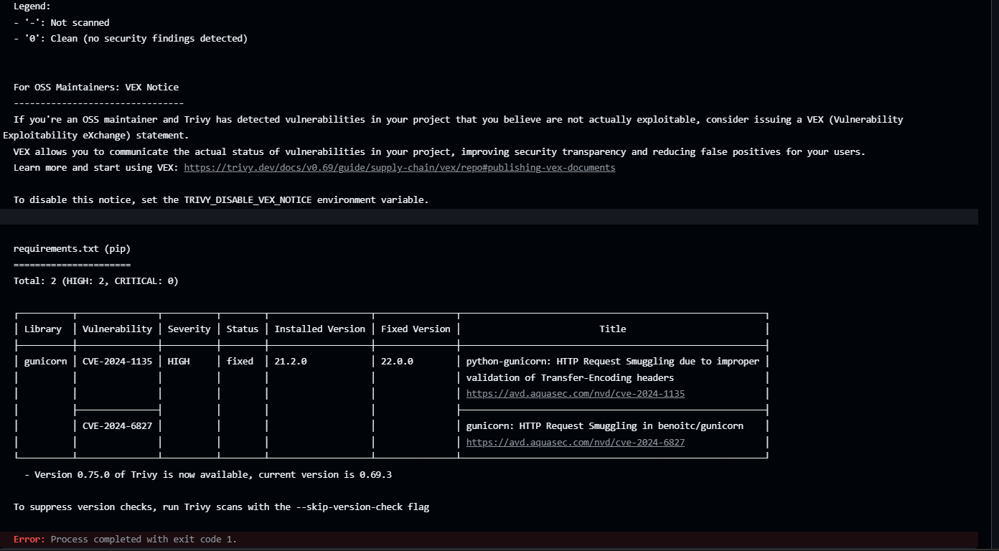
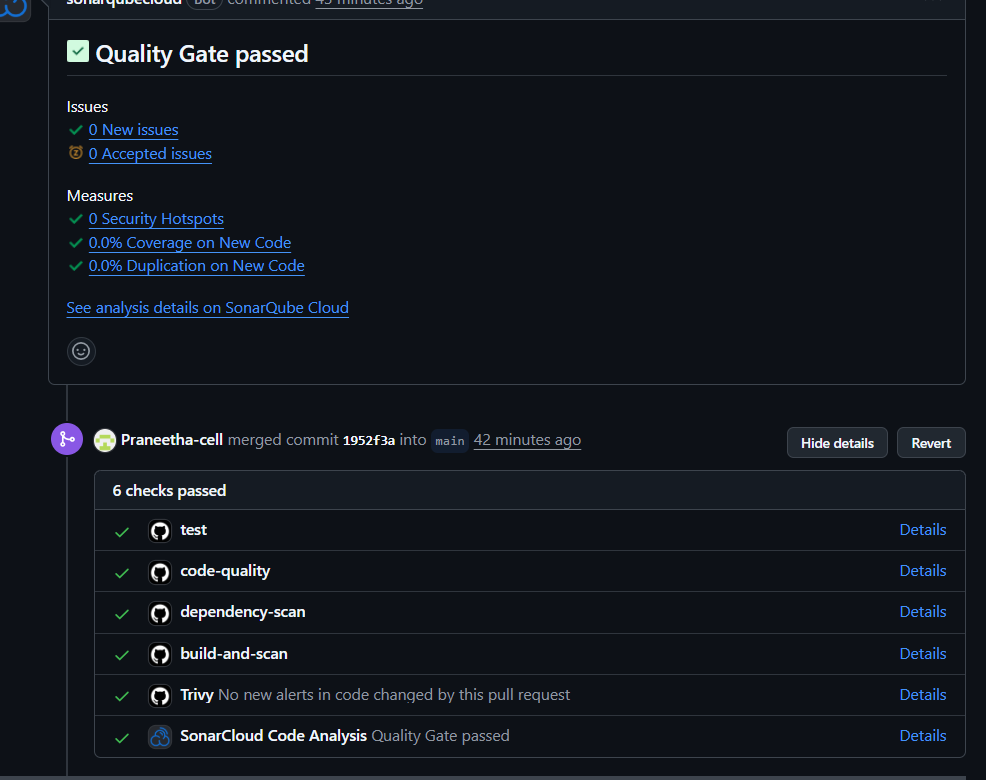
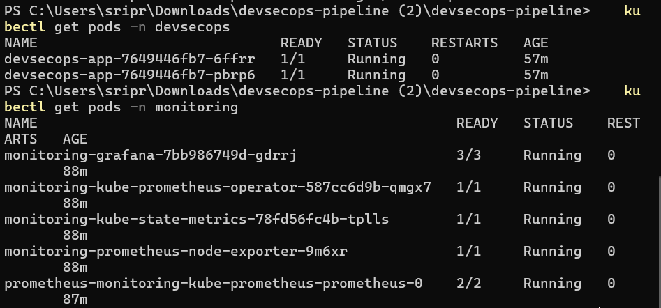
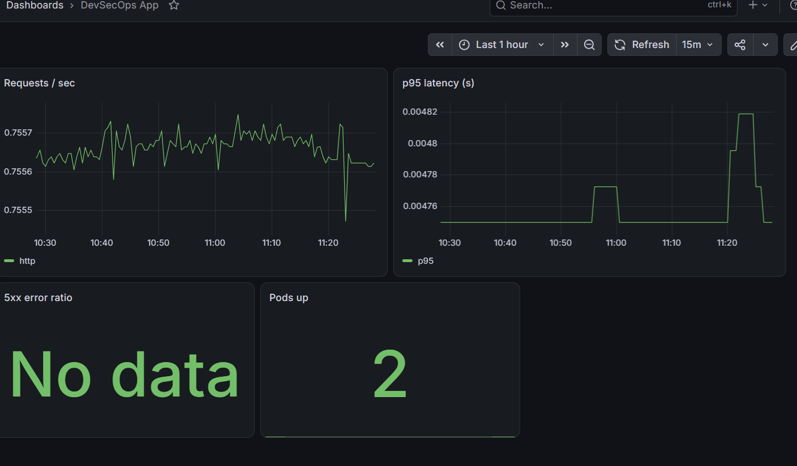

# DevSecOps Pipeline

A pipeline where **code cannot reach production unless it passes security checks**.
The app is deliberately tiny (a Flask service); the pipeline around it is the project.

```
Developer -> Git -> GitHub -> CI/CD (GitHub Actions)
   |
   |-- 1. Unit tests (pytest + coverage)
   |-- 2. Code quality + SAST (SonarQube quality gate, Bandit)
   |-- 3. Dependency / secret / IaC scan (Trivy fs)
   |-- 4. Docker build -> Container scan (Trivy image)   <-- SECURITY GATE
   |-- 5. Push to ECR (only if every gate is green)
   '-- 6. Deploy to EKS -> Prometheus + Grafana watch it
```

Any gate that fails stops the pipeline: the `deploy` job `needs` every earlier job, and the image is
**not pushed to the registry** until the scans pass.

## Layout

| Path | Purpose |
|---|---|
| `app/`, `tests/` | Flask service with `/healthz` and Prometheus `/metrics`, plus pytest tests |
| `Dockerfile` | Multi-stage, non-root (uid 10001), healthcheck |
| `.github/workflows/ci-cd.yml` | The pipeline with all gates |
| `Jenkinsfile` | Same gates for Jenkins, if you prefer it |
| `sonar-project.properties` | SonarQube config (waits for the quality gate) |
| `k8s/` | Namespace (restricted Pod Security), Deployment, Service, HPA, NetworkPolicy |
| `terraform/` | VPC, ECR (immutable tags, scan on push), EKS, GitHub OIDC deploy role |
| `monitoring/` | kube-prometheus-stack values, ServiceMonitor, alert rules, Grafana dashboard |
| `docker-compose.sonar.yml` | Local SonarQube for experimenting |

## Setup

### 1. Run locally
```bash
python -m venv .venv && source .venv/bin/activate
pip install -r requirements-dev.txt
pytest
docker build -t devsecops-app:local .
trivy image --severity HIGH,CRITICAL devsecops-app:local   # try the gate yourself
docker run -p 8080:8080 devsecops-app:local
```

### 2. Provision AWS with Terraform
```bash
cd terraform
cp terraform.tfvars.example terraform.tfvars   # set github_repo and your IP
terraform init
terraform plan
terraform apply
```
Note the `github_actions_role_arn` output. Then create the namespace once with your own admin credentials
(the deploy role is deliberately limited to the `devsecops` namespace, so it cannot create it):
```bash
aws eks update-kubeconfig --name devsecops-eks --region ap-south-1
kubectl apply -f k8s/namespace.yaml
``` (EKS and a NAT gateway cost real money; run `terraform destroy` when done.)

### 3. GitHub secrets
Repo -> Settings -> Secrets and variables -> Actions:

| Secret | Value |
|---|---|
| `AWS_ROLE_ARN` | `github_actions_role_arn` from Terraform |
| `SONAR_TOKEN` | token generated in SonarQube |
| `SONAR_HOST_URL` | e.g. `https://sonar.example.com` |

Also create a GitHub **Environment** named `production` and add required reviewers for a manual approval step.
If you update `AWS_REGION` / cluster names in the workflow, keep them in sync with Terraform.

### 4. Monitoring
```bash
helm repo add prometheus-community https://prometheus-community.github.io/helm-charts
helm install monitoring prometheus-community/kube-prometheus-stack \
  -n monitoring --create-namespace -f monitoring/prometheus-values.yaml \
  --set grafana.adminPassword='<strong password>'
kubectl apply -f monitoring/app-monitoring.yaml -f monitoring/grafana-dashboard.yaml
kubectl -n monitoring port-forward svc/monitoring-grafana 3000:80
```

## Proving the gate works (good for demos)
1. Downgrade to a vulnerable dependency in `requirements.txt` (for example `gunicorn==21.2.0`, which has a known HIGH CVE fixed in 22.0.0): the **Trivy fs** job fails. Pick one that still lets the unit tests pass, otherwise the pipeline stops at the test job and never reaches the scan.
2. Change the Dockerfile base to an old image: the **container scan** fails and nothing is pushed.
3. Commit a fake secret such as `AWS_SECRET_ACCESS_KEY=...`: Trivy secret scanning fails.
4. Add a `# TODO`-heavy, untested function: the **SonarQube quality gate** fails.

## Hardening notes
- AWS auth uses GitHub OIDC, so there are no long-lived keys. The role is limited to pushes to `main`.
- Pods run as non-root with a read-only root filesystem, dropped capabilities, and a default-deny-ish NetworkPolicy.
- Pin GitHub Actions to commit SHAs for stricter supply-chain security.
- `ignore-unfixed: true` keeps the gate from blocking on CVEs with no available patch; remove it for a stricter gate.
- Possible extensions: image signing with cosign, SBOM generation (`trivy image --format cyclonedx`), OPA/Kyverno admission policies.

## Proof it works

### 1. Vulnerable code is blocked
A pull request that downgraded `gunicorn` to 21.2.0 failed the Trivy dependency scan, and GitHub disabled the Merge button.




### 2. Clean code passes every gate
Tests, Bandit, SonarQube Cloud quality gate, Trivy scans and the Docker build all pass. The deploy job is skipped until AWS is configured.



### 3. Kubernetes deployment (local kind cluster)
The app runs as 2 replicas with a restricted pod security profile, read-only filesystem, non-root user and a network policy.



### 4. Monitoring with Prometheus and Grafana
The app exposes `/metrics`. Prometheus scrapes it through a ServiceMonitor, Grafana shows requests per second, p95 latency, error ratio and pods up, and alert rules (AppDown, HighErrorRate, HighLatencyP95) are loaded.



## Run it locally (Windows, free)
1. Start Docker Desktop and install `kind`, `kubectl` and `helm` (`winget install Kubernetes.kind Kubernetes.kubectl Helm.Helm`).
2. `kind create cluster --name devsecops`
3. `powershell -ExecutionPolicy Bypass -File .\scripts\local-k8s.ps1`
4. `kubectl -n devsecops port-forward svc/devsecops-app 18080:80`
5. `kubectl -n monitoring port-forward svc/monitoring-grafana 3000:80` and open http://localhost:3000 (admin / admin12345, local demo only).
6. `.\scripts\traffic.ps1 -Errors` to generate traffic.
7. Clean up: `kind delete cluster --name devsecops`

## Status
- Done and tested: CI security gates, branch protection, Docker image, local Kubernetes, Prometheus and Grafana.
- Written but not applied: AWS infrastructure (Terraform, ECR, EKS) and the cloud deploy job, to avoid cloud cost. Set the `DEPLOY_ENABLED` variable and `AWS_ROLE_ARN` secret after running Terraform to enable it.
